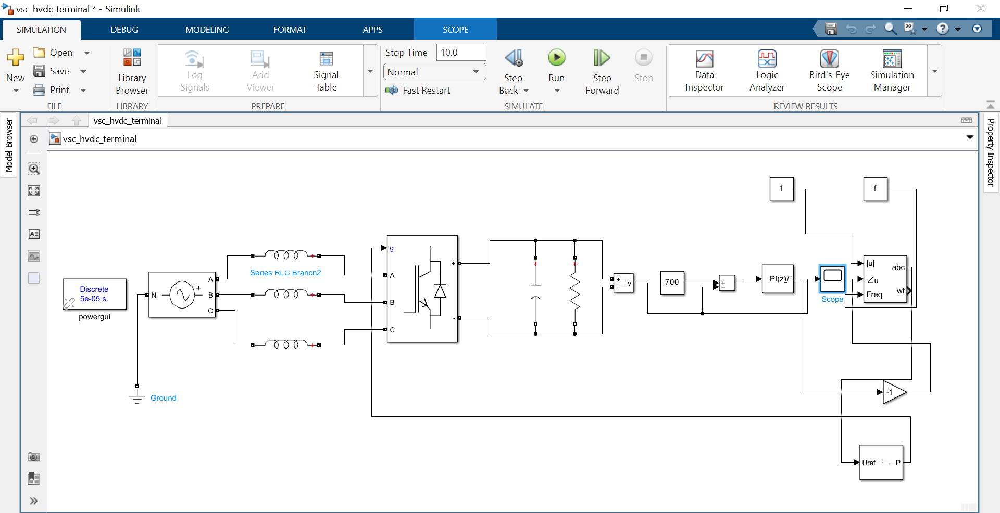
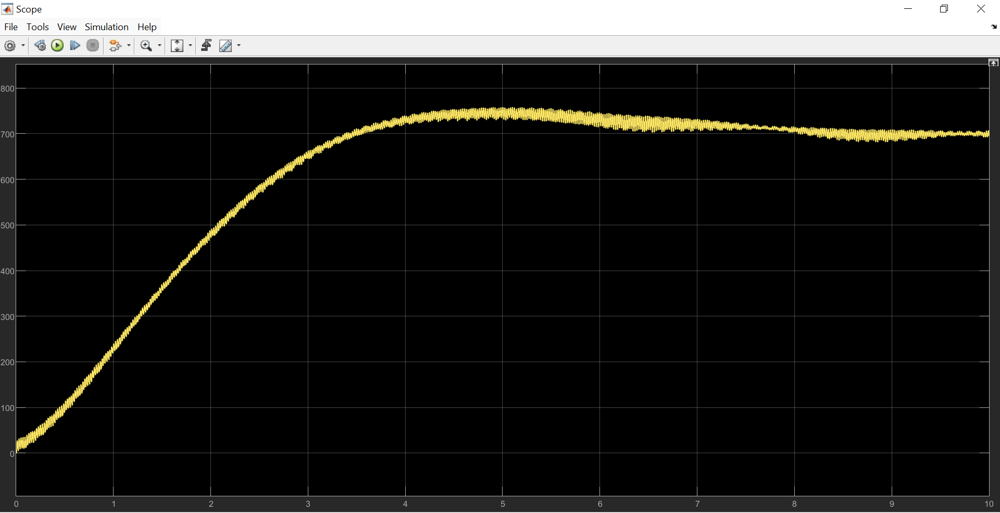
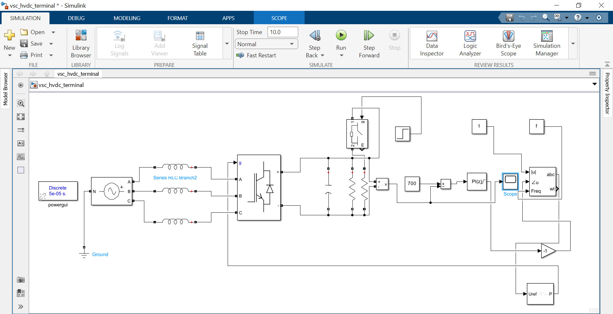
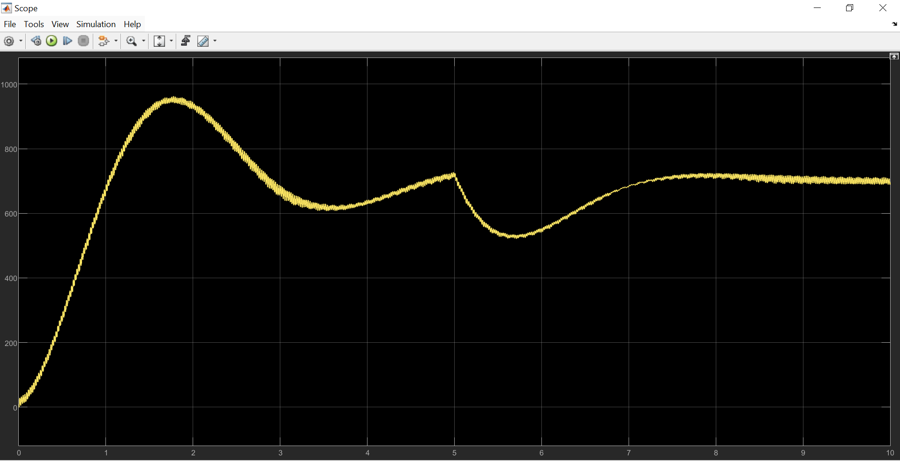

# VSC-HVDC Terminal Digital Twin & Control System

**Author:** Oloore Issa Abayomi   
**Domain:** Power Electronics, Digital Control Systems, HVDC Transmission  

## Overview
This repository contains a closed-loop digital twin of a Voltage Source Converter (VSC) acting as an HVDC terminal. Built in MATLAB/Simulink (Simscape Electrical), the system demonstrates dynamic phase-shift control of a grid-tied IGBT bridge. The project is executed in two phases: establishing a critically damped steady-state baseline, followed by implementing a robust control upgrade to survive severe transient load disturbances.

---

## Phase 1: Steady-State Phase-Shift Control
### Baseline Architecture

The initial physical plant establishes the core HVDC mechanics[cite: 20]:
* **AC Grid:** 400V RMS, 50Hz 3-phase programmable source.
* **Buffer:** 10mH AC line reactors to suppress high-frequency PWM switching ripple.
* **Converter:** 6-pulse IGBT/Diode Universal Bridge.
* **DC Link:** 20mF capacitive buffer targeting a 700V steady-state DC bus.

### Baseline Tuning & Performance

To pull real power from the grid without saturating the PWM logic, the digital brain commands the phase angle ($\delta$) rather than voltage amplitude. 
* A discrete-time PI controller is initially tuned with highly gentle parameters (**$K_p = 0.001$, $K_i = 0.01$**) to prevent capacitive overvoltage.
* The PI output is restricted to a maximum 15-degree lag.
* **Result:** The system executes a perfectly smooth, critically damped charge cycle, settling at exactly 700V without any dangerous overshoot[cite: 21].

---

## Phase 2: Dynamic Disturbance & Robust Recovery
### Fault-Testing Architecture

To test grid resilience, the architecture was upgraded with a disturbance trap. An ideal switch, triggered by a discrete step block at $t = 5.0s$, instantly drops a secondary 50-ohm load in parallel with the main bus, doubling the active power demand.

### Robust Tuning & Disturbance Rejection

*(Note: Refer to `scripts/init_params.m` for the full variable initialization)*

The initial gentle PI gains were too sluggish to catch a sudden voltage collapse. The control loop was retuned for dynamic aggression:
* **Updated Gains:** **$K_p = 0.002$, $K_i = 0.05$**
* **Expanded Guardrails:** PI output saturation limit increased from 15 to 45 degrees, granting the controller the necessary headroom to pull emergency power.
* **Result:** When the grid fault hits at 5.0s, the voltage physically collapses to ~520V. The retuned PI controller instantly detects the error, aggressively shifts the modulation phase angle to pull tens of kilowatts of extra power, and carves a mathematically precise recovery curve right back to the 700V target.

---

## How to Run
1. Clone the repository: `git clone https://github.com/FC-Pascal/VSC-HVDC-Digital-Control.git`
2. Open MATLAB and run `scripts/init_params.m` to load the physical and tuning variables into the workspace.
3. Open `simulink_models/vsc_hvdc_terminal.slx` and execute the simulation.